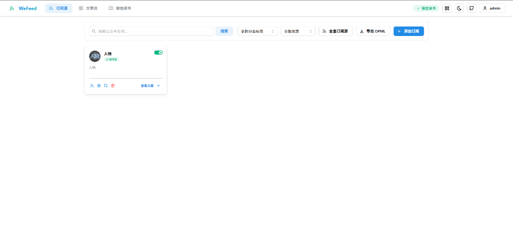
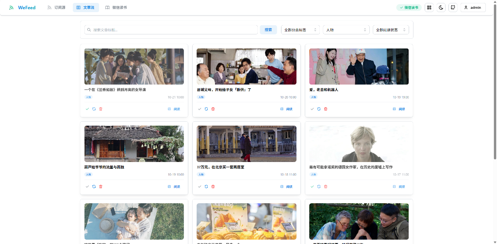

<div align="center">


# WeFeed

轻量、纯净、开箱即用的微信公众号与微信读书 RSS 聚合订阅服务。

[](LICENSE)
[](https://github.com/Aquarius-Situla/we-feed/pkgs/container/we-feed)
[](#)
[]()

[简体中文](README.zh-CN.md) | [English](ReadMe.md)

</div>

---

## 📌 项目初衷 (Why WeFeed?)

**WeFeed** 是一个专为自托管用户打造的微信公众号 RSS 订阅与内容归档服务。

本项目 Fork 自开源项目 [rachelos/we-mp-rss](https://github.com/rachelos/we-mp-rss)。原项目在公众号 RSS 抓取方面提供了很好的思路，但在实际自建部署与长期日常使用中，存在几个难以回避的问题，这也是我们决定独立维护并彻底重构 WeFeed 的原因：

### 1. 彻底剔除第三方追踪脚本，防止服务器 IP 与域名泄露
原项目在前端与后台硬编码注入了百度统计等外部脚本。当用户在自己的 VPS 或家庭服务器自建部署时，服务器的真实公网 IP、私有域名以及后台访问路径会被静默上报到第三方统计平台，这对注重私密性与安全性的自托管用户来说是不可接受的。
> **WeFeed 彻底移除了所有外部追踪、遥测与第三方统计脚本**，做到 100% 本地自包含与纯净，绝不上报任何私有数据。

### 2. 剥离冗余模块，重构现代化轻量前端
原项目随着迭代集成了许多与核心 RSS 订阅无关的功能，例如内置的小说阅读器、监控宿主机 CPU 与内存占用的系统监控面板等。这些非必要模块不仅让前端打包体积膨胀、页面交互卡顿，也让整个工具显得过于臃肿杂乱。
> **WeFeed 果断做减法，剥离了小说阅读器、系统资源监控等无关面板**，并基于现代前端技术栈全面重构了 Web 管理界面。界面轻快清爽、交互直观，专注于订阅源管理、文章流浏览与正文阅读。

### 3. 长效运行与自托管稳定性加固
针对自托管时高频遇到的微信公众平台与微信读书风控阻断、Cookie 频繁失效、单号阅读配额耗尽等痛点，底层增加了**多账号配额自动轮换**、**容器原生浏览器定时保活**以及**防盗链隔离**，无需在宿主机编写繁琐的外部 cron 脚本即可长期稳定自运行。

---

## ✨ 核心特性

- **🛡️ 纯净自托管**：无任何外部统计代码，保护服务器真实 IP、反代域名与访问记录隐私。
- **🎨 轻量现代面板**：去除小说和系统监控等非核心面板，响应迅速，支持移动端自适应与暗黑模式。
- **👥 多账号配额轮换**：支持同时绑定多个微信读书凭据，单账号额度耗尽时自动无缝接续，保障抓取不中断。
- **⏰ 原生无头自动保活**：容器内置后台保活守护线程，智能模拟人类作息时间自动刷新，告别 Cookie 手动维护。
- **📡 标准 Feed 全兼容**：生成标准 RSS 2.0、Atom 与 JSON 格式 Feed，无缝接入 FreshRSS、Miniflux、Feedly、NetNewsWire、Follow 等主流阅读器。
- **🖼️ 微信防盗链优化**：内置 Referrer 隔离策略与正文过滤，阅读器与 Web 端均可正常展示封面与正文高清插图，不再“裂图”。
- **🐳 原生多架构镜像**：提供 GitHub Actions 自动构建的 `linux/amd64` 与 `linux/arm64` 官方镜像，完美适配 x86 服务器、ARM NAS 与树莓派。

---

## 🖥️ 界面预览 (UI Preview)

重构后的 WeFeed 界面清爽轻巧，彻底移除了冗余的小说阅读与系统监控面板，专注订阅与内容聚合：

<div align="center">

### 订阅源管理
简洁直观的公众号卡片管理，支持一键获取全量/单个 RSS/Atom 订阅源、导出 OPML、分类标签与状态筛选。



### 文章流浏览
清爽的卡片式文章瀑布流，支持按公众号与阅读状态筛选、封面图反防盗链优化与抽屉式正文阅读。



</div>

---

### 方式一：Docker Compose（推荐）

新建 `docker-compose.yml` 文件：

```yaml
version: "3.8"

services:
  we-feed:
    image: ghcr.io/aquarius-situla/we-feed:latest
    container_name: we-feed
    restart: always
    ports:
      - "8001:8001"
    environment:
      - TZ=Asia/Shanghai
      - RSS_BASE_URL=http://localhost:8001  # 服务外部访问完整地址（如 https://rss.example.com）
      - RSS_FULL_CONTEXT=True               # 是否在 RSS 输出中包含全文 HTML
      - GATHER.CONTENT=True                 # 是否自动抓取并清洗文章全文
      - GATHER.MODEL=weread_mp              # 采集引擎：推荐 weread_mp
      - SPAN_INTERVAL=15                    # 定时同步周期（分钟）
    volumes:
      - ./data:/app/data
```

启动服务：

```bash
docker compose up -d
```

---

### 方式二：Docker CLI 单行运行

```bash
docker run -d \
  --name we-feed \
  --restart always \
  -p 8001:8001 \
  -e TZ=Asia/Shanghai \
  -e RSS_BASE_URL=http://localhost:8001 \
  -e GATHER.MODEL=weread_mp \
  -v $(pwd)/data:/app/data \
  ghcr.io/aquarius-situla/we-feed:latest
```

---

## 🔑 默认登录凭据

- **Web 管理界面**：`http://<服务器IP>:8001`
- **默认管理员账号**：`admin`
- **默认初始密码**：`admin@123`

> [!TIP]
> - 本项目定位为**自托管私有聚合工具**，出于安全防护与微信配额防滥用考虑，系统默认不开放公网注册。
> - 您可以在 `docker-compose.yml` 中通过环境变量 `USERNAME` 与 `PASSWORD` 覆盖默认初始密码。

---

## 📖 核心使用指南

### 1. 绑定微信读书凭据（推荐通道）
1. 登录管理后台，点击侧边栏进入 **微信读书管理** 页面；
2. 点击 **扫码授权**，使用微信号扫描二维码完成绑定；
3. （可选）如需多账号保障，可继续点击 **扫码授权（添加账号）** 绑定备用微信号。当主号每日配额耗尽后，系统将自动轮换，确保订阅更新不中断。

### 2. 添加与订阅公众号
1. 进入 **公众号管理** 页面；
2. 通过搜索框输入公众号名称检索并添加，或直接输入微信文章链接一键解析添加；
3. 添加完成后，后台将自动执行初次文章同步与全文抓取。

### 3. 获取 RSS 订阅链接
1. 在公众号列表或概览页面中，点击公众号卡片上的 **RSS / Atom 复制按钮**；
2. 复制生成的链接（例如 `http://<你的域名>:8001/feed/<MP_ID>.xml`）；
3. 将链接粘贴至 FreshRSS、Miniflux、Feedly 等阅读器中，即可实现公众号文章聚合阅读。

---

## ⚙️ 常用环境变量速查

| 环境变量 | 默认值 | 说明 |
|---|---|---|
| `USERNAME` | `admin` | 超级管理员初始用户名 |
| `PASSWORD` | `admin@123` | 超级管理员初始密码 |
| `RSS_BASE_URL` | `http://localhost:8001` | 服务外部访问根域名，用于决定生成的 RSS 订阅链接前缀 |
| `RSS_FULL_CONTEXT` | `True` | 是否在 Feed 中输出文章完整正文与配图 |
| `GATHER.MODEL` | `weread_mp` | 核心采集通道：`weread_mp`（微信读书通道，推荐）、`web` 或 `app` |
| `GATHER.CONTENT` | `True` | 入库时是否自动抓取文章全文内容 |
| `SPAN_INTERVAL` | `15` | 定时全量同步轮询间隔（分钟） |
| `MAX_PAGE` | `1` | 微信读书单次抓取最大翻页数 |
| `PROXY_URL` | *(空)* | 可选 HTTP/SOCKS 出口代理（如微信封锁数据中心 IP 时使用） |
| `SSO_TRUST_PROXY` | `False` | 是否信任前置反向代理 SSO（如 Authelia / Nginx-UI），支持私有内网免密通行 |
| `WEREAD_AUTO_KEEPALIVE` | `True` | 容器原生无头浏览器自动保活微信读书 Cookie |

---

## ⭐ 支持项目 (Support Us)

如果 WeFeed 改善了你的公众号文章订阅与阅读体验，欢迎在 [GitHub](https://github.com/Aquarius-Situla/we-feed) 上为本项目点亮一颗 **Star** ⭐！你的支持是我们持续迭代与维护的最大动力。

---

## 📜 开源协议与致谢 (License & Acknowledgements)

本项目采用 **[GNU Affero General Public License v3.0 or later (AGPL-3.0-or-later)](LICENSE)** 协议开源。

```text
Copyright (C) 2026 WeFeed Community <https://github.com/Aquarius-Situla/we-feed>
Copyright (C) 2024-2026 rachelos <https://github.com/rachelos/we-mp-rss>
```

### 原项目致谢
WeFeed 是基于开源项目 **[rachelos/we-mp-rss](https://github.com/rachelos/we-mp-rss)** 派生与重构的社区维护版本。根据原项目 **MIT License** 规范，我们在此完整保留并声明原作者的版权信息：

> **MIT License**  
> Copyright (c) 2025 RACHEL  
> Mail: rachelos@qq.com  
> 
> *The original code from we-mp-rss is licensed under the MIT License. See [LICENSE](LICENSE) for details.*
